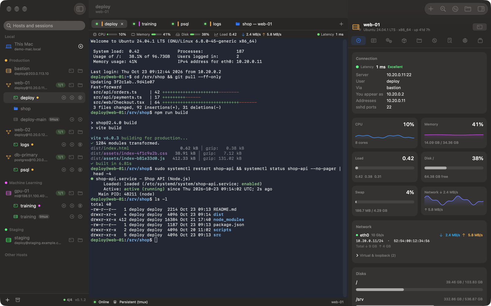
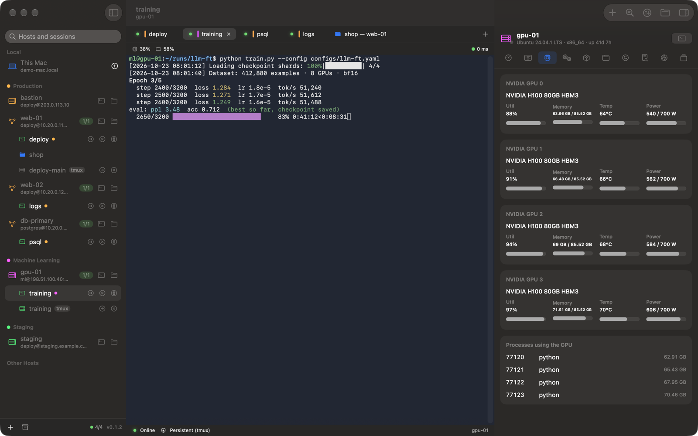
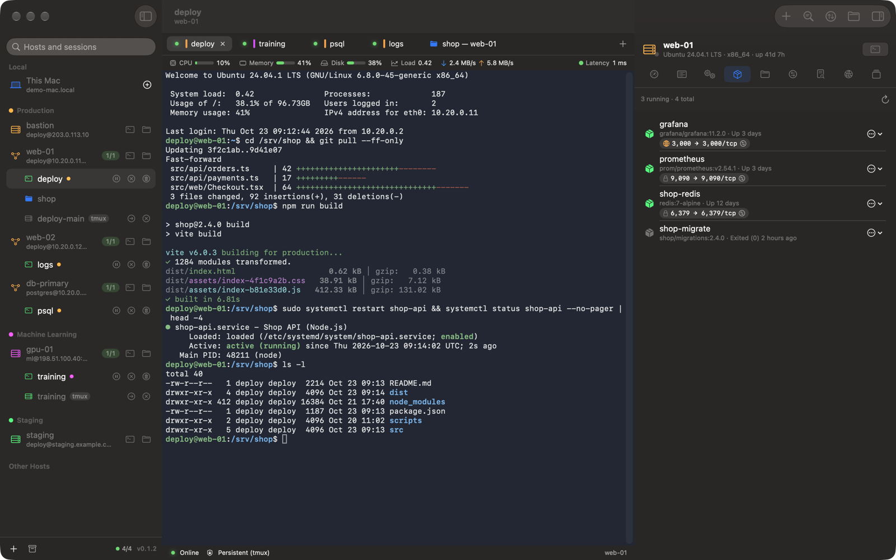
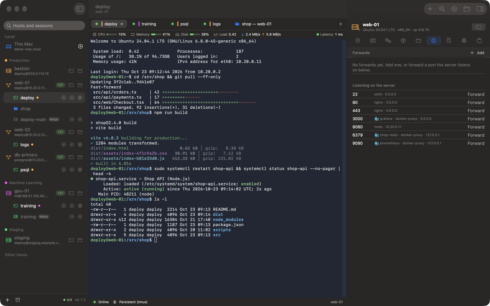
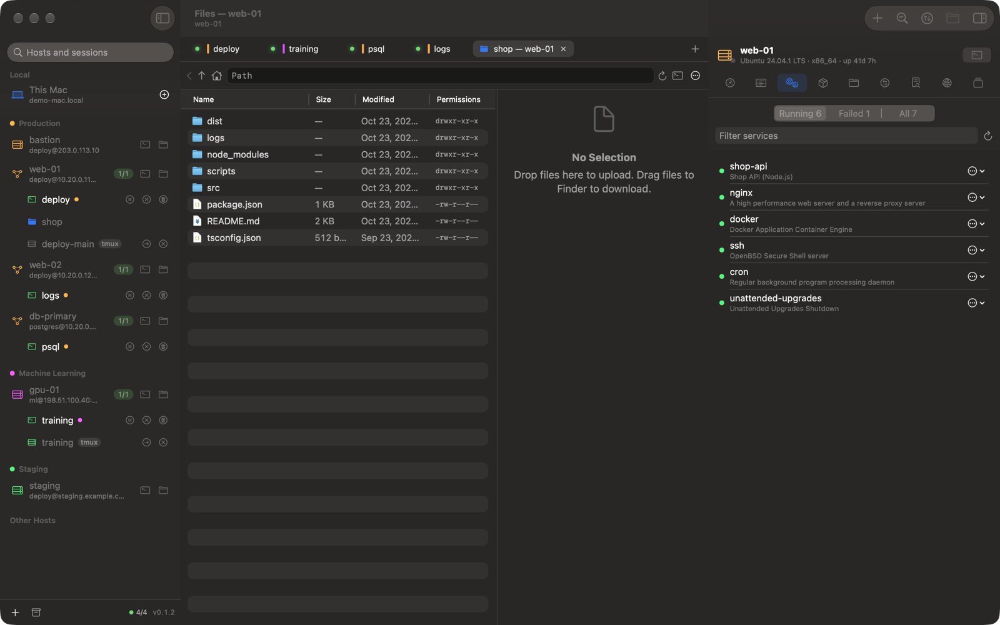
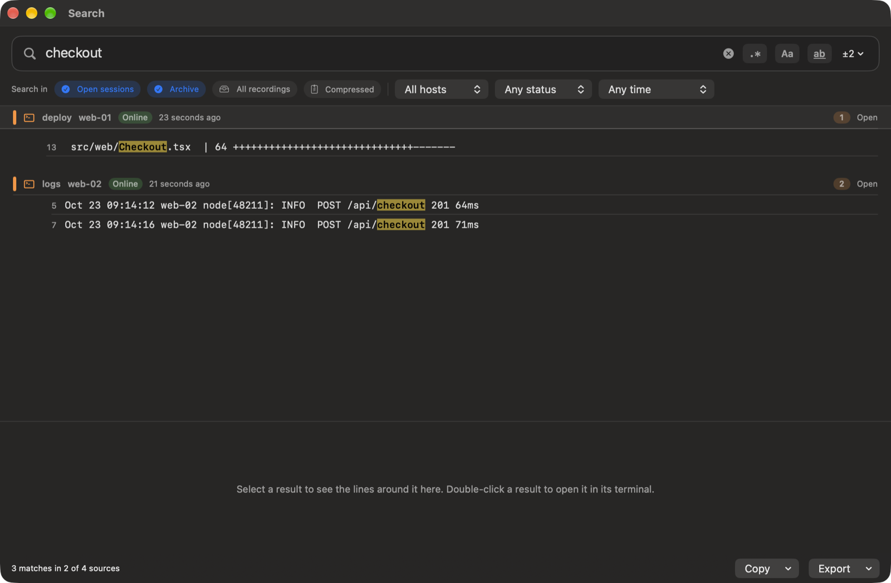

# Tether

**SSH sessions that survive the network.** A native macOS SSH client built with SwiftUI.

Version 0.3.2 · [github.com/WhileEndless/tether](https://github.com/WhileEndless/tether) · [Release notes](release-notes/)

Tether keeps your remote work alive when Wi‑Fi drops or your Mac sleeps, without installing anything on the server. It also manages your `~/.ssh/config`, transfers files with drag and drop, and shows live system information for every host — Linux, macOS, BSD and Windows.



> Requires macOS 26 or later. Tether is an early release (0.3.2): expect rough edges, and please [report issues](https://github.com/WhileEndless/tether/issues).

## Screenshots

All screenshots use synthetic demo data (`make demo`); no real hosts are shown.

| | |
| --- | --- |
|  |  |
| GPU server with a training run | Docker containers with their published ports |
|  |  |
| Listening ports, one click to forward | File manager tab with services |



Search across every terminal, the archive and recordings.

## Features

**Sessions that survive**
- **Nothing to install on the server.** On connect, Tether checks what the server already has:
  - **tmux ≥ 3.0** → runs it in *control mode* (`tmux -CC`). You never see tmux's UI. Scrolling, selecting and copying are native, and the session keeps running on the server.
  - **GNU screen** → a screen session with local scrollback kept intact.
  - **Neither** → a plain login shell, with automatic reconnects and a local transcript.
- **Clear states.** *Online*, *Waiting* (connection lost: history stays visible, input is paused) and *Dead* (the remote session is confirmed gone: read-only and archived). A lost network is detected immediately, and a stalled server within seconds. Tabs reattach when the network returns, and also after the app is quit or crashes.
- **Background sessions.** Close a tab and keep its session running in the background. Your own tmux sessions on a server are listed too, and you can attach to them. Leftover sessions can be cleaned up.
- **See what runs in them without attaching.** Each server session shows the command and folder of its active window (the tooltip and the host panel list every window). Coding agents are recognised: Claude Code, Codex and opencode show the name of their session — the one you gave it or the one the agent chose — on server sessions and on open tabs, and whether Claude Code is working. Names come from the agents' own files on the server (Codex and opencode need `sqlite3` there unless you named the Codex thread yourself; otherwise the terminal title is used). The lists refresh on their own while a tab to the host is open; the sidebar's Refresh button (↻) reloads them and the SSH config at once.
- **Save a session** with ⌘S (*File ▸ Save Session…*): everything it has shown, including output no longer in memory (read from its recording), as plain text or as the raw output with colors. Tether remembers the folder and format you chose last.

**Passwords, Touch ID and sudo**
- Saving passwords is optional: tick *Remember in Keychain* when signing in (works for every jump host and for SSH key passphrases).
- Saved passwords stay in the macOS login keychain. Optionally Touch ID (or your Mac's password) is asked before one is used, then not again for a time you choose; locking the screen always asks again.
- A saved password only answers its own host: never a server's own prompt text naming another host, never a jump host asking for the target's password.
- When a terminal asks for a password — `sudo`, `su`, `ssh` to another host, a key passphrase — a bar offers to fill a saved one (⌥⌘P) or to type one in a secure field and save it. Passwords are kept per user: sudo's for the user who runs it, su's for the account it switches to (also on macOS, where both just ask "Password:"). Only sudo is filled automatically, and only while sudo itself is waiting; a password is never typed into a shell (where it would land in the shell history and the recording). Secure Keyboard Entry is on while a terminal waits for a password.
- A saved password that stops working (changed on the server) is not sent again: you are asked for the current one, which replaces it. Saved passwords can also be replaced or removed in Settings ▸ Passwords.

**Security**
- **App Lock** (off by default): Touch ID or the Mac password, or a separate Tether password. Every window is covered until Tether is unlocked; sessions keep running meanwhile. Coming back to Tether asks for Touch ID right away. Optionally locks when the Mac sleeps or its screen locks; ⌃⌘L or the toolbar's lock button locks at once.
- **Encrypted recordings** (off by default, a simple on/off switch): AES-256-GCM, hardware accelerated, with the key kept behind your Tether password (set when you turn it on, typed twice). Turning it on encrypts every recording, existing and compressed ones too; turning it off decrypts them again. Search, transcripts and scrolling back work as usual. Forgot the password? *Reset* (after typing RESET and the Mac's own check) removes it and the recordings nobody can open any more, and keeps everything else.
- Security settings are also kept in the keychain, so other programs cannot quietly switch them off; weakening one asks for Touch ID or the Mac password.

**Windows servers**
- Windows 10/11 and Windows Server with OpenSSH (cmd or PowerShell as the default shell) are detected automatically. Nothing is installed.
- PowerShell terminals, the file manager (drives, upload/download, rename, move, copy, delete), transfers, and the host panel: system, processes, services, network, listening ports, connections, event logs, NVIDIA GPUs and containers.
- Windows has no tmux or screen, so a shell there ends with its connection (its output stays in the recording).

**Terminal**
- xterm-256color and true color, mouse reporting, alternate screen, Option as Meta (off by default, so Option types your layout's characters such as @), and key mappings. vim, htop, fzf and emacs work as expected.
- Uses this Mac's Terminal.app profile (colors, font, translucency) by default.
- Terminal.app navigation: ⌘↑/⌘↓ jump between commands, ⇧⌘↑/⇧⌘↓ select whole commands, and PageUp/PageDown/Home/End scroll.
- Tab names follow the running command (or the current directory), and you can rename any tab.
- Local terminals on this Mac. These are persistent too when tmux is installed locally.

**Tabs and windows**
- Each window has its own tabs. Switching only swaps the terminal (instant); the sidebar and panels stay in place.
  - double-click to rename
  - live status dots
  - hold ⌘ to see tab numbers (⌘1…⌘9; ⌃Tab and ⇧⌘[ ] to cycle)
  - drag a tab out into its own window, or onto another window's tab bar
  - middle-click to close; the mouse wheel scrolls the tab bar, and ⌄ lists every tab
- ⌘P quick switcher and Merge All Windows. Only the visible tab is drawn, so many tabs stay cheap.
- ⌘T opens a new tab to the same host in the folder the current tab's shell is in, like Terminal.app — locally and on servers. New tabs open next to the current one. Both can be changed in Settings ▸ General.
- **Notifications from programs.** When Claude Code finishes or has a question, when a long job prints `\e]9;done\a`, or when the bell rings in a tab you are not looking at, the tab gets a bell and macOS shows a notification; clicking it brings the tab to the front. The common sequences are understood: OSC 9 (iTerm2 style), OSC 777 (rxvt, Ghostty), OSC 99 (kitty) and the bell — so any of Claude Code's notification channels works.
- Close a tab to keep its session in the background, or terminate it. You can also terminate every session on a host at once.
- *Disconnect & Move to Background* drops the connection but leaves tmux/screen running on the server. The session shows as *Suspended* and reattaches when you open it again.
- File managers open as tabs too, next to terminals. Each keeps its directory and selection, even in the background.

**Hosts and connections**
- Comment-preserving editor for `~/.ssh/config` (and `Include`d files), with backups before each save.
- Jump host chains (ProxyJump), each hop with its own saved password.
- *Identify by name* (HostKeyAlias), so an address reused on another network is not confused with your host.
- Direct connections (user, host, port, jump host, password or key) without saving anything.
- One authenticated connection per host (ControlMaster), shared by terminals, transfers, monitoring and port forwards.
- Passwords stay in the keychain and reach `ssh` via a private askpass bridge. A wizard can generate and install an Ed25519 key; it is offered only when key login doesn't already work.
- **Port forwarding:**
  - local, remote and SOCKS forwards saved per host, with auto-start
  - conflict checks with free-port suggestions
  - one-click forwarding of ports the server listens on
  - forwards are restored automatically after a reconnect

**Host panel**
- A live status bar above every terminal: CPU, memory, disk, load, GPU, latency and active forwards.
- Connection details: server address and port, the address you appear as, sshd ports, and latency with jitter and a quality rating.
- Metrics with sparklines, disks, and **GPUs** (NVIDIA via `nvidia-smi`, including unified-memory systems such as DGX Spark; AMD via `rocm-smi` or sysfs).
- Processes with signals, **systemd services** (start, stop, restart, logs), and **Docker/Podman containers** with their published ports and whether each is public or local only.
- **Kubernetes**: pods (status, ready containers, restarts, node, age) and nodes of the cluster that `kubectl`, k3s, microk8s or `oc` on the host can reach, filtered by namespace or name, with logs, describe and Delete Pod.
- **Listening ports:**
  - every TCP/UDP port the server listens on, with the process and container behind it
  - grouped by reach: all interfaces, one interface, or local only
  - one-click forwarding to this Mac
- **Network:**
  - per-interface download/upload rates, addresses, MAC and link speed
  - real interfaces first, virtual ones folded away
- System, auth and kernel logs, logged-in users, and connections (SSH detected by sshd's real ports).
- Monitoring streams over one channel and only runs while something is visible.

**Files**
- Remote file browser as a tab, a panel or a full window, with drag and drop in both directions, Quick Look and details.
- Directories you have visited open instantly from a cache and refresh in the background, keeping scroll position and selection.
- *Browse Files Here* (the terminal's current directory) and *Open Terminal Here*.
- Transfers show what went where, speed, amount transferred and ETA. Many files travel as one packed stream (tar on both ends, nothing written to disk in between); others are copied several at a time. Both are configurable.
- **Drop or paste files into a terminal** to upload them — Finder files, the screenshot thumbnail, or an image on the clipboard (⌃⇧⌘4 screenshots are saved as PNG first): Tether asks for a destination (Return accepts `/tmp`), uploads, then types the remote path(s) at the prompt. Existing files are never overwritten — a free name such as `report-1.pdf` is chosen instead. In local terminals (this Mac) nothing is copied: the file's own path is typed (a pasted image is saved as a PNG first, and kept for a week).
- Copy files in the file manager and paste them in Finder (and the other way round). Bulk move, copy, permissions, compress, rename and delete.

**Search**
- Search every open terminal, the archive and old recordings, with plain text or regex, case sensitivity and whole words.
- Filter by host, session, status and time (presets such as *Last 15 minutes* or an exact from/to range).
- Results show highlighted context. Double-click a result to open the terminal (or transcript) at that line; the terminal keeps the search, so ⌘G / ⇧⌘G step through the other matches there.
- Copy lines, matches or ranges. Export results as text, CSV or JSON, or export full transcripts.
- Long sessions are covered too: output that was dropped from memory is searched in the recording, without duplicates.
- A progress bar shows which source is being searched, and you can stop at any time. Compressed recordings are skipped unless you include them.

**Long sessions and the menu bar**
- No limit on how long a session runs: memory keeps a set number of lines, and scrolling further reads earlier output back from disk without a visible break (view and selection stay in place).
- Closing the window keeps Tether and every session running in the menu bar; the icon brings the window back with its tabs.
- After quitting — or a crash — every window comes back with its tabs, selected tab, size, position and full-screen state.
- Dozens of tabs to one host: logins are queued and terminals are spread over several shared connections (servers allow 10 sessions per connection by default).
- Monitoring pauses while no Tether window is visible, and recordings are written in large batches to spare the SSD.

**Local backups.**
- Every session's output is recorded locally and can be replayed read-only.
- Recordings older than 7 days are compressed (LZFSE, typically 5–10× smaller).
- The 1 GB limit (default) removes the oldest recordings first.
- Only a configurable number of lines stays in memory. Older output is opened from disk with "Open Full History", which loads large recordings in slices.

## Keyboard shortcuts

Anything with ⌘ belongs to the app. Everything else — Ctrl keys, Option (characters, or Meta if you turn it on), Esc, function keys — goes straight to the terminal, so vim, emacs, tmux bindings and fzf behave as usual. The full, searchable list is in **Help ▸ Keyboard Shortcuts** (⌘/) and in **Settings ▸ Keyboard**.

| | |
| --- | --- |
| New connection / quick connect (host search) / tab to same host / local terminal | ⌘N / ⌘↩ / ⌘T / ⌥⌘T |
| Close tab / close window | ⌘W / ⇧⌘W |
| Next / previous tab | ⇧⌘] ⇧⌘[ (also ⌃Tab, ⌥⌘→ ⌥⌘←) |
| Tab 1…8 / last tab · go to any session | ⌘1…⌘8 / ⌘9 · ⌘P |
| Move tab to background / disconnect to background | ⇧⌘B / ⌥⇧⌘B |
| Terminate session | ⌥⇧⌘W |
| Save the whole session to a file | ⌘S |
| Fill a saved password (sudo, su, ssh prompt) | ⌥⌘P |
| Lock Tether (with App Lock on) | ⌃⌘L |
| Jump between commands / select a command's output | ⌘↑ ⌘↓ / ⇧⌘↑ ⇧⌘↓ |
| Find in terminal / search all sessions | ⌘F (⌘G, ⇧⌘G, ⌘E) / ⇧⌘F |
| Browse files here / file manager window / transfers | ⇧⌘O / ⌥⌘O / ⌥⌘L |
| Sidebar / host panel | ⌃⌘S / ⌥⌘I |
| Clear scrollback · font size | ⌘K · ⌘+ ⌘- ⌘0 |

Menu shortcuts can be changed in System Settings ▸ Keyboard ▸ Keyboard Shortcuts ▸ App Shortcuts. Terminal key mappings (for example ⌘← → Ctrl-A) are set in Settings ▸ Keyboard.

## Install

### Requirements

- macOS 26 or later. Release downloads are built for Apple silicon; on an Intel Mac, build from source.
- To build: Xcode 26 or the matching Command Line Tools (Swift 6.2). Check with `swift --version`.
- On servers: nothing. tmux or GNU screen make sessions persistent if they are there; `tar` (present almost everywhere) speeds up transfers of many files.

### From a release

1. Download `Tether-<version>.zip` from [Releases](https://github.com/WhileEndless/tether/releases) and unzip it.
2. Move `Tether.app` to `/Applications`.
3. The app is not notarized yet, so macOS blocks the first launch. Either **right-click Tether.app ▸ Open ▸ Open**, or allow it in **System Settings ▸ Privacy & Security ▸ Open Anyway**. From a terminal you can instead run:
   ```sh
   xattr -dr com.apple.quarantine /Applications/Tether.app
   ```

### From source

```sh
git clone https://github.com/WhileEndless/tether.git
cd tether
make install          # builds a release and copies it to /Applications
```

Or `make run` to build and open it from `dist/` without installing. A build made on your own Mac is not quarantined, so it opens without the warning.

### Updating

Quit Tether, then install the new version over the old one (`git pull && make install` from source). Settings, hosts, sessions and recordings are kept. Sessions that were open reattach on the next launch.

Tether is not signed with a developer certificate, so to the keychain every new version is a new app: the first time a new version uses a saved password (or the recording key), macOS asks whether Tether may use it. Choose *Always Allow*. Tether's own security settings are read without asking.

### Uninstalling

```sh
make uninstall        # or drag /Applications/Tether.app to the Trash
```

Your data stays until you remove it:

| What | Where |
| --- | --- |
| Settings, host groups, session list, recordings | `~/Library/Application Support/Tether` |
| Saved passwords | Login keychain (search for "Tether" in Keychain Access) |
| Your SSH config | `~/.ssh/config` — Tether edits it only when you save a host, and keeps a backup |

Tether sessions that are still running on servers can be ended from the sidebar (*Terminate*) before uninstalling, or later with `tmux kill-session -t tether-…` on the server.

### First steps

1. **⌘N** to connect: pick a host from your ssh config or type `user@host:port`, optionally with a jump host.
2. Hosts from `~/.ssh/config` appear in the sidebar. Click one to see its status; double-click to open a terminal.
3. **⌥⌘I** shows the host panel (system, processes, services, containers, ports, logs). **⇧⌘O** opens a file manager in the terminal's current folder.
4. **⌘/** lists every keyboard shortcut.

## Building

```sh
make                  # build the app → dist/Tether.app
make help             # list all targets
make build            # compile (debug)
make test             # unit and local integration tests — no server needed
make app              # release build → dist/Tether.app
make debug            # debug build → dist/Tether.app
make zip              # dist/Tether-<version>.zip for a release
make demo             # open the app with synthetic data (SHOTS=1 saves screenshots)
make check            # privacy scan + release notes + tests
make clean            # remove build products
```

`make` only wraps `swift build`, `swift test` and `scripts/build-app.sh`; you can run those directly. The app is ad-hoc signed. To distribute it without the first-launch warning, sign and notarize it with your own Developer ID.

## Architecture

Tether is a Swift package split into small modules:

| Module | Responsibility |
| --- | --- |
| `TetherCore` | Models, settings, paths, keychain |
| `SSHConfigKit` | Round-trip-safe `ssh_config` parser and editor |
| `SSHTransport` | ssh/scp arguments, ControlMaster, askpass bridge, remote command runner |
| `TmuxControl` | tmux control mode protocol parser and command encoder |
| `SessionKit` | Terminal sessions, remote bootstrap, persistence and reconnect state machine |
| `TerminalUI` | SwiftTerm-based terminal view, themes, key mappings |
| `RecordingKit` | Session transcripts and storage quota |
| `FileTransferKit` | Remote file listing and scp transfers |
| `MonitorKit` | System, process, log and connection probes |
| `KeySetupKit` | Key generation and installation |
| `SearchKit` | Search over live terminals and recordings, export |
| `TetherApp` | The SwiftUI application |
| `TetherAskPass` | Tiny `SSH_ASKPASS` helper that forwards prompts to the app |

Tether runs the system `/usr/bin/ssh`, so everything in your ssh config works: agents, FIDO keys, `ProxyCommand`, certificates, `Include`.

### How persistence works

When a terminal connects, Tether runs a short POSIX `sh` script on the server. It chooses tmux, screen or a plain shell, reports the choice with a private escape sequence, and `exec`s into it. On reconnect, Tether asks only to *re-attach*. If the session no longer exists, the tab is marked dead and archived instead of quietly starting a new shell.

## Privacy

Tether talks only to the hosts you connect to. Settings, host groups and recordings stay in `~/Library/Application Support/Tether` (recordings can be encrypted, see Security). Passwords stay in your login keychain.

Nothing else is sent anywhere: no analytics, no telemetry. At launch Tether asks GitHub once whether a newer release exists (Settings ▸ General can turn this off); if GitHub cannot be reached, nothing happens.

## Contributing

Issues and pull requests are welcome. See [CONTRIBUTING.md](CONTRIBUTING.md) and the project rules in [CLAUDE.md](CLAUDE.md) (privacy, English only, one release-notes file per version).

## License

Tether is released under the [MIT License](LICENSE). It uses [SwiftTerm](https://github.com/migueldeicaza/SwiftTerm) (MIT); see [THIRD_PARTY_NOTICES.md](THIRD_PARTY_NOTICES.md).

Tether is an independent project and is not affiliated with Apple, tmux or GNU screen.
